<div align="center">

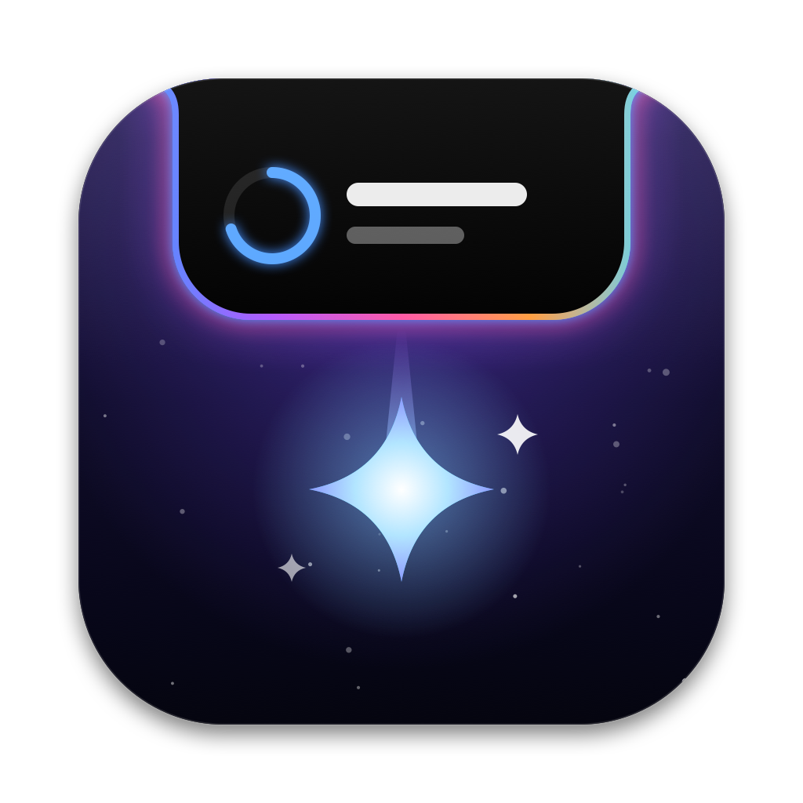

# Notchfall

**Meeting, reminder and timer alerts that drop out of your MacBook's notch.**

A tiny macOS menu-bar app. When a meeting is about to start, a black island grows out of the
notch, springs open with a glowing rim and gives you a big **Join** button.

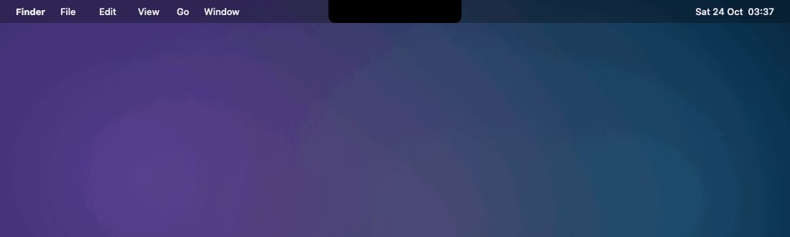

</div>

---

## What it does

| | |
|---|---|
| **Drops out of the notch** | Alerts grow out of the camera housing, like the Dynamic Island on an iPhone. First a small bulge, then a spring with a little overshoot. The content blurs into place, then a ripple rings out. |
| **Join in one click** | Finds the Google Meet, Zoom or Microsoft Teams link in the event and puts it on a big **Join** button. |
| **🪞 Camera check** | One click on the alert opens a live, mirrored camera preview inside the island, so you can fix your hair before you **Join**. The camera only runs while it's open. |
| **🎙 On air** | While you're on a call, a slim island shows a red mic light, a camera light and the time left in the meeting. In the last 5 minutes the rim starts to glow, and if another meeting starts straight after, it shows **Next: Sprint Planning at 15:00**. Works with every meeting app. |
| **🎵 Now Playing** | While Apple Music or Spotify plays, the album cover sits in the left wing and a little equaliser, tinted by the cover, dances in the right. Hover the notch for the player: cover, progress, ⏮ ⏯ ⏭. |
| **Pauses for meetings** | When a meeting alert drops, the music pauses. Dismiss or snooze and it plays again; join the call and it waits until the call is over. |
| **Live countdown** | In the minutes before a meeting, a ring and the minutes left sit either side of the notch. The rim starts to glow in the last minute. |
| **Up next on hover** | Move the pointer onto the notch and the island opens into your next four items (three under the player), each with its own join button. |
| **Gets more urgent** | The rim's gradient turns faster as the start gets close and goes red once the meeting is live. The title shimmers, and the badge pulses. |
| **Reminders and timers** | Apple Reminders that are due today (opt-in), plus quick timers from the menu. Each kind has its own colour. |
| **Never covered by the notch** | Text always sits in the "wings" either side of the camera. Nothing important is drawn behind it. |
| **No notch? Still works** | On a Mac or external screen without a notch, the island hangs from the middle of the menu bar. |

<table>
<tr>
<td>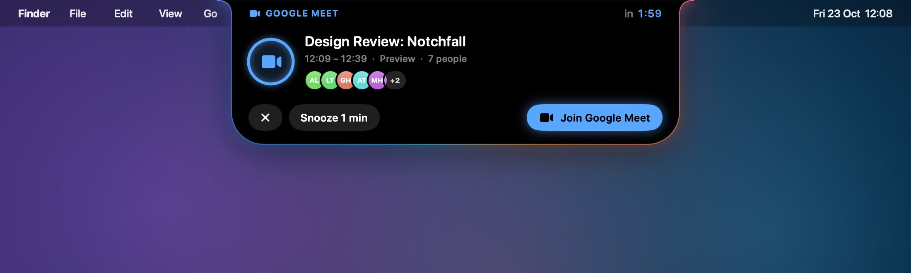</td>
<td>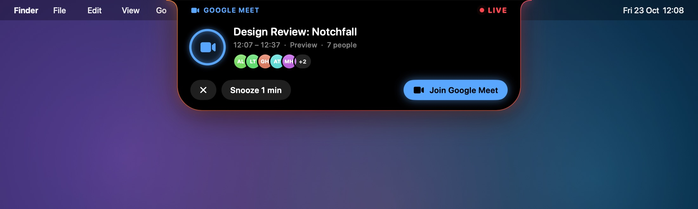</td>
</tr>
<tr>
<td align="center"><sub>2 minutes before: rolling countdown and a draining ring</sub></td>
<td align="center"><sub>Live: red LIVE tag, full ring, shimmering title</sub></td>
</tr>
<tr>
<td>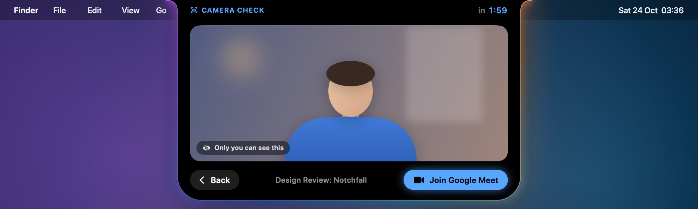</td>
<td>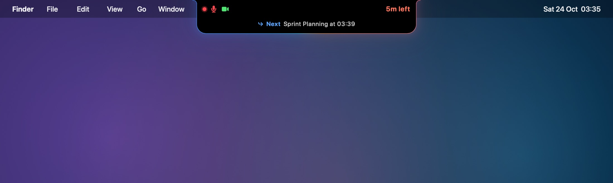</td>
</tr>
<tr>
<td align="center"><sub>🪞 Camera check before you join</sub></td>
<td align="center"><sub>🎙 On air: mic and camera lights, time left, what's next</sub></td>
</tr>
<tr>
<td>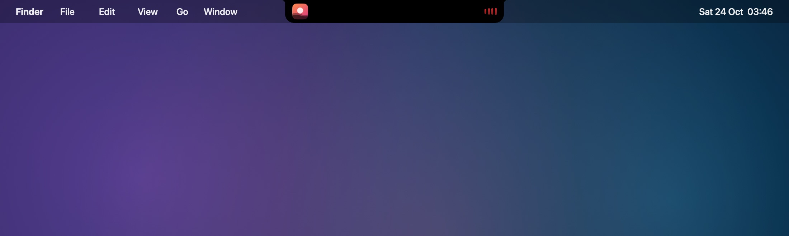</td>
<td>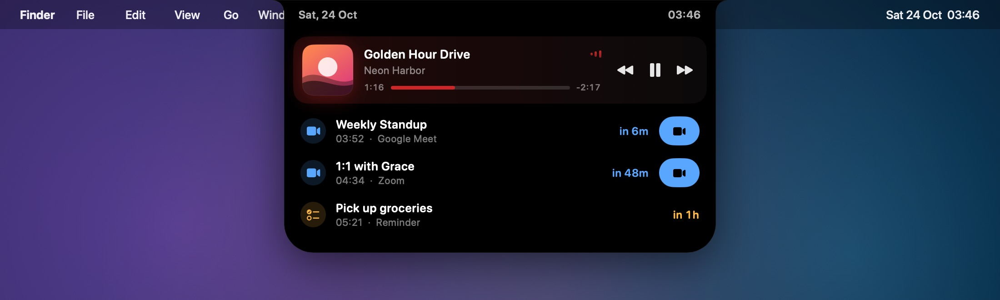</td>
</tr>
<tr>
<td align="center"><sub>🎵 Now Playing in the wings</sub></td>
<td align="center"><sub>Hover: the player on top of Up next</sub></td>
</tr>
<tr>
<td>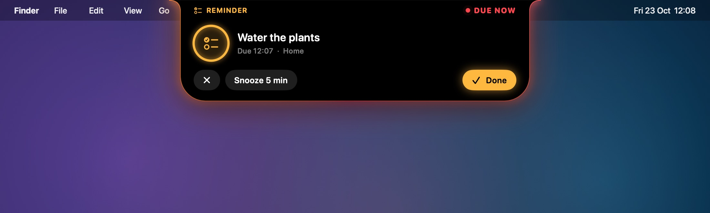</td>
<td>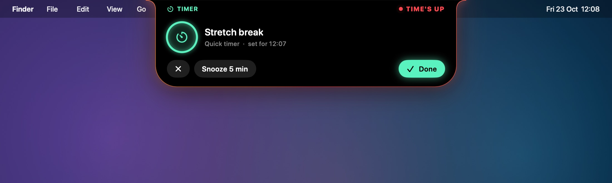</td>
</tr>
<tr>
<td align="center"><sub>Apple Reminders (amber)</sub></td>
<td align="center"><sub>Quick timers (mint)</sub></td>
</tr>
<tr>
<td>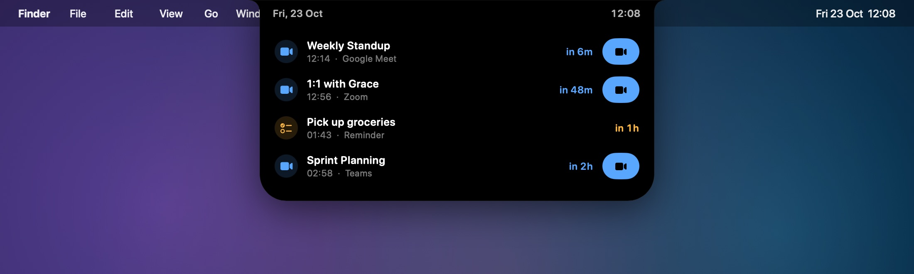</td>
<td>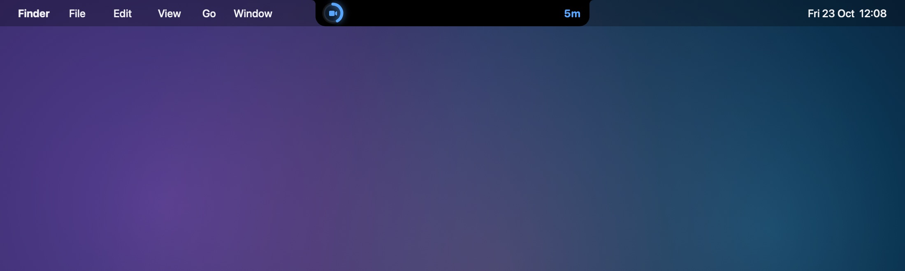</td>
</tr>
<tr>
<td align="center"><sub>Hover the notch: Up next</sub></td>
<td align="center"><sub>Live countdown in the wings</sub></td>
</tr>
</table>

<sub>The screenshots use made-up events and songs (the app's built-in previews) on a mock desktop. The
camera check shows a drawn stand-in, not a real camera.</sub>

---

## Requirements

- macOS 14 Sonoma or later, on Apple Silicon or Intel.
- A MacBook with a notch looks best. Any Mac works.
- Your calendars in the macOS **Calendar** app. iCloud, Google, Exchange and Outlook
  accounts added in System Settings → Internet Accounts all count.

Work-managed Macs: some company security tools block apps that aren't signed by an
identified developer. If **Open Anyway** doesn't appear in step 3 below, ask your IT team to
allow the app.

---

## Install

1. Download **Notchfall.dmg** from the [latest release](../../releases/latest).
2. Open it and drag **Notchfall** into **Applications**.
3. Open Notchfall from Applications.

   The first time, macOS will block it with a message that it "can't be opened" or is from an
   unidentified developer. This is expected, because the app isn't notarized by Apple. To
   allow it:
   - Open **System Settings → Privacy & Security**.
   - Scroll down to the message about Notchfall and click **Open Anyway**, then confirm.

   Or, in Terminal:
   ```
   xattr -dr com.apple.quarantine /Applications/Notchfall.app
   ```
4. When asked, click **Allow** for Calendar access.
5. Look at the menu bar: Notchfall's icon is a little island with dots falling out of it. Next
   to it is the time until your next meeting, for example `12m`. There's no Dock icon and no
   window.

To see it right away, open the menu and choose **✨ Preview an alert → Take the tour**.

### Build from source

```
git clone https://github.com/Sravankumartangudu/notchfall.git
cd notchfall
./build.sh --install     # builds a universal app into ~/Applications and opens it
```

You only need the Xcode Command Line Tools (`xcode-select --install`). `./build.sh --dist` also
makes `build/Notchfall.dmg` and `build/Notchfall.zip`.

---

## Using it

| You want to… | Do this |
|---|---|
| Join a meeting | Click **Join** on the alert, or the join button in **Up next**, or the meeting in the menu. |
| Be reminded again | **Snooze**: 1 minute for meetings, 5 minutes for reminders and timers. |
| Close an alert | **✕**, or **Done** when there's no link. |
| See what's next | Hover the notch, or open the menu. |
| Set a timer | Menu → **⏱ Quick timer** → a preset, or **New timer with a label…** |
| Control the music | Hover the notch: ⏮ ⏯ ⏭ on the player. |
| Check your camera | Click 🪞 on a meeting alert. **Back** returns to the alert; **Join** joins. |
| Try the animation | Menu → **✨ Preview an alert** → any item, or **Drop a test alert** (⌘T). |

When alerts appear:

| Item | Shows | Still shows if you were away |
|---|---|---|
| Meeting | at your lead time (2 min by default) | up to 5 min after it started |
| Reminder | at your lead time | up to 1 hour late |
| Quick timer | when it ends | always, even after sleep |

Only one alert shows at a time. The next one waits until you close the current one.

---

## Settings

Everything is under **⚙ Settings** in the menu.

| Setting | Options |
|---|---|
| **Island → Alert drops** | 1, 2, 3, 5 or 10 min before |
| **Island → Live countdown beside the notch** | Off, or from 5, 10, 15 or 30 min before (default 10) |
| **Island → Open "Up next" when hovering the notch** | On / off |
| **Island → On air indicator during calls** | Off; During calendar meetings (default); Whenever the mic or camera is on |
| **Island → Show Now Playing (Music, Spotify)** | On (default) / off |
| **Island → Pause music when a meeting alert drops** | On (default) / off |
| **Island → Glow colours** | Aurora, Neon, Ember, Ice, Mono |
| **Island → Show on** | The built-in screen with the notch, or the main screen |
| **Sound → Alert sound** | Off, Glass, Hero, Ping, Pop, Purr, Submarine, Tink |
| **Sound → Voice announcement** | Speaks "Design Review starts in 2 minutes." |
| **What to alert for** | Only meetings with video links; Include Apple Reminders |
| **App → Appearance** | System, Light or Dark for the menu and dialogs. The island is always dark. |
| **App → Launch at login** | On / off |

---

## Privacy

Notchfall reads your calendars, and reminders if you turn them on, **on your Mac only**. It has
no server, no account, no analytics and no network access of its own (one exception below, for
Spotify covers). Clicking **Join** opens the meeting link in your browser or meeting app.

- **Camera check** asks for camera access the first time you use it. The picture is only shown in
  the island; it's never recorded or saved, and the camera turns off when you close it.
- **On air** only checks *whether* a microphone or camera is in use (the same signal that lights
  macOS's orange and green dots). It never hears or sees anything, and needs no permission.
- **Now Playing** asks Music and Spotify what's playing, using the same AppleScript that Shortcuts
  uses. macOS asks once per app whether Notchfall may control it. Notchfall only talks to a player
  that's already open, so it never launches one. Apple Music covers come straight from the Music
  app; Spotify only gives a link, so Notchfall downloads that one cover image from Spotify's image
  server.

---

## Troubleshooting

**macOS says the app is damaged or can't be opened.**
Run `xattr -dr com.apple.quarantine /Applications/Notchfall.app` in Terminal, then open it again.

**The menu says "Calendar access denied".**
Click that line, or go to System Settings → Privacy & Security → Calendars, and turn Notchfall on.

**The alert didn't appear.**
Check the timing table above. If you dismissed the alert earlier, it won't come back. If the
meeting has no video link, check that **Only meetings with video links** is off.

**Hovering the notch does nothing.**
Hover only works on a screen with a real notch, and only if **Open "Up next" when hovering
the notch** is on. On other screens, use the menu.

**The island shows on the wrong screen.**
Settings → Island → **Show on**.

**On air shows when I'm not on a call.**
Some apps keep the microphone open in the background. Set **On air indicator during calls** to
**During calendar meetings** (the default) so it only shows while a meeting is on.

**Camera check says access is off.**
System Settings → Privacy & Security → Camera, and turn Notchfall on.

**Now Playing doesn't show.**
Notchfall needs permission to control the player: System Settings → Privacy & Security →
Automation → Notchfall, and turn on **Music** and/or **Spotify**. Also check Settings → Island →
**Show Now Playing**. Other players (browsers, Podcasts) aren't supported.

**I also use T-Minus.**
Both apps would alert for the same meeting. Keep one running, or set one to **Only meetings
with video links**.

---

## Credits

Notchfall shares its calendar and timer engine with
[T-Minus](https://github.com/Sravankumartangudu/t-minus), and its island is inspired by the
iPhone's Dynamic Island and the many notch apps for the Mac.

## License

[MIT](LICENSE)
